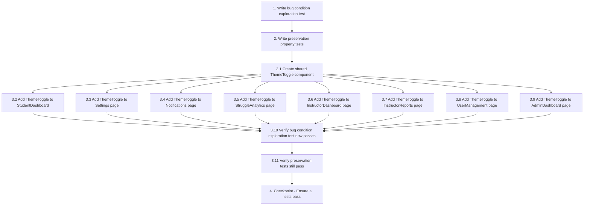

# Implementation Plan

## Overview
This task list implements the fix for inconsistent dark mode behavior across the A-Quire frontend application. The implementation follows the bugfix workflow with exploration tests first, then implementation, then verification.

## Tasks

- [x] 1. Write bug condition exploration test
  - **Property 1: Bug Condition** - Missing Theme Toggle and Non-Responsive Colors
  - **CRITICAL**: This test MUST FAIL on unfixed code - failure confirms the bug exists
  - **DO NOT attempt to fix the test or the code when it fails**
  - **NOTE**: This test encodes the expected behavior - it will validate the fix when it passes after implementation
  - **GOAL**: Surface counterexamples that demonstrate the bug exists
  - **Scoped PBT Approach**: For deterministic bugs, scope the property to the concrete failing cases to ensure reproducibility
  - Test that authenticated pages (StudentDashboard, Settings, Notifications, StruggleAnalytics, InstructorDashboard) contain theme toggle buttons in their headers
  - Test that when `.dark` class is applied to document root, pages using hardcoded colors (e.g., `bg-white`, `text-stone-900`) do NOT respond (remain light colored)
  - The test assertions should match Property 1 (Theme Toggle Access) and Property 2 (Color Responsiveness) from design
  - Concrete test cases:
    - StudentDashboard: query header for `.theme-toggle` button → expect FOUND (will FAIL initially)
    - Settings: query header for `.theme-toggle` button → expect FOUND (will FAIL initially)
    - StudentDashboard with `.dark` applied: check computed background-color of main card → expect dark color (will FAIL, shows white)
    - Settings with `.dark` applied: check computed color of heading text → expect light color (will FAIL, shows dark stone)
  - Run test on UNFIXED code
  - **EXPECTED OUTCOME**: Test FAILS (this is correct - it proves the bug exists)
  - Document counterexamples found to understand root cause:
    - Which pages lack theme toggle buttons in headers
    - Which elements use hardcoded Tailwind classes (`bg-white`, `text-stone-900`, `border-stone-200`)
    - Which computed styles remain light when `.dark` class is applied
  - Mark task complete when test is written, run, and failures are documented
  - _Requirements: 1.1, 1.2, 1.3, 1.4, 1.5_

- [x] 2. Write preservation property tests (BEFORE implementing fix)
  - **Property 2: Preservation** - ThemeContext and Working Pages Unchanged
  - **IMPORTANT**: Follow observation-first methodology
  - Observe: Navigate to ProgressAnalytics page - theme toggle button is present and functional (observe on unfixed code)
  - Observe: Navigate to MyCourses page - theme toggle works and colors respond correctly (observe on unfixed code)
  - Observe: Click theme toggle on ProgressAnalytics - localStorage updates with 'aq-theme' key and `.dark` class is toggled on document root (observe on unfixed code)
  - Observe: Pages with sidebar components use `.sidebar-dark` and `.sidebar-light` classes with fixed color schemes (observe on unfixed code)
  - Write property-based test: for all pages that already implement theme toggles correctly (ProgressAnalytics, MyCourses, LessonPlayer, CourseDetail), verify:
    - DOM structure of header with toggle button remains unchanged
    - Clicking toggle calls `ThemeContext.toggle()` and updates localStorage
    - Computed styles in both light and dark modes match unfixed code
  - Write property-based test: ThemeContext functionality remains unchanged:
    - `toggle()` function updates localStorage with 'aq-theme' key
    - `toggle()` adds/removes `.dark` class on `document.documentElement`
    - App initializes with stored theme preference from localStorage
    - App honors OS preference when no stored preference exists
  - Write property-based test: for pages with sidebar components, verify `.sidebar-dark` and `.sidebar-light` styles are NOT modified
  - Write property-based test: for public pages (Home, Features, Login, SignUp), verify no theme toggle is added and styling remains unchanged
  - Verify tests PASS on UNFIXED code (confirms baseline behavior to preserve)
  - _Requirements: 3.1, 3.2, 3.3, 3.4, 3.5, 3.6_

- [ ] 3. Fix for inconsistent dark mode implementation

  - [x] 3.1 Create shared ThemeToggle component
    - Extract ThemeToggle component to `Frontend/src/components/ThemeToggle.jsx`
    - Import `useTheme` from `'../contexts/ThemeContext'`
    - Import `Sun` and `Moon` icons from `'lucide-react'`
    - Component renders button with `.theme-toggle` class
    - Button displays Sun icon (amber-400) in dark mode, Moon icon in light mode
    - Button calls `toggle()` from `useTheme()` hook on click
    - Add appropriate title attribute for accessibility
    - _Bug_Condition: isBugCondition(page) where page.header does NOT contain ThemeToggleButton_
    - _Expected_Behavior: All authenticated pages display theme toggle button in header (Property 1 from design)_
    - _Preservation: ThemeContext functionality unchanged (Property 3 from design)_
    - _Requirements: 2.1, 2.3, 2.5, 3.1_

  - [x] 3.2 Add ThemeToggle to StudentDashboard
    - Import `ThemeToggle` component in `Frontend/src/pages/StudentDashboard.jsx`
    - Add `<ThemeToggle />` to header, positioned between search/controls and notification bell
    - Ensure proper flex container with gap spacing
    - Convert hardcoded background colors:
      - Replace `bg-white` with `bg-[var(--card-bg)]` or `.app-card` utility
      - Replace `bg-stone-50` with `bg-[var(--surface)]`
      - Replace `bg-stone-100` with `bg-[var(--surface-2)]`
    - Convert hardcoded text colors:
      - Replace `text-stone-900` with `text-[var(--text)]`
      - Replace `text-stone-800` with `text-[var(--text)]`
      - Replace `text-stone-600`, `text-stone-500` with `text-[var(--text-muted)]`
      - Replace `text-stone-400` with `text-[var(--text-faint)]`
    - Convert hardcoded border colors:
      - Replace `border-stone-200` with `border-[var(--border)]`
      - Replace `border-stone-300` with `border-[var(--border-2)]`
    - **Exception**: Do NOT modify sidebar elements with `.sidebar-dark` or `.sidebar-light` classes
    - _Bug_Condition: isBugCondition(StudentDashboard) where hasThemeToggle=false OR usesHardcodedColors=true_
    - _Expected_Behavior: StudentDashboard displays theme toggle and responds to dark mode (Properties 1 and 2 from design)_
    - _Preservation: Sidebar styling unchanged_
    - _Requirements: 1.1, 1.2, 1.4, 2.1, 2.2, 2.4, 2.6, 3.5_

  - [x] 3.3 Add ThemeToggle to Settings page
    - Import `ThemeToggle` component in `Frontend/src/pages/Settings.jsx`
    - Add `<ThemeToggle />` to topbar/header
    - Convert hardcoded colors to CSS custom properties following same pattern as StudentDashboard
    - **Exception**: Do NOT modify sidebar elements
    - _Bug_Condition: isBugCondition(Settings) where hasThemeToggle=false OR usesHardcodedColors=true_
    - _Expected_Behavior: Settings page displays theme toggle and responds to dark mode_
    - _Preservation: Sidebar styling unchanged_
    - _Requirements: 1.1, 1.2, 1.5, 2.1, 2.2, 2.4, 2.5, 2.6, 3.5_

  - [x] 3.4 Add ThemeToggle to Notifications page
    - Import `ThemeToggle` component in `Frontend/src/pages/Notifications.jsx`
    - Add `<ThemeToggle />` to header if missing
    - Convert hardcoded colors to CSS custom properties
    - _Bug_Condition: isBugCondition(Notifications) where hasThemeToggle=false OR usesHardcodedColors=true_
    - _Expected_Behavior: Notifications page displays theme toggle and responds to dark mode_
    - _Requirements: 1.1, 1.2, 2.1, 2.2, 2.4, 2.6_

  - [x] 3.5 Add ThemeToggle to StruggleAnalytics page
    - Import `ThemeToggle` component in `Frontend/src/pages/StruggleAnalytics.jsx`
    - Add `<ThemeToggle />` to header if missing
    - Convert hardcoded colors to CSS custom properties
    - _Bug_Condition: isBugCondition(StruggleAnalytics) where hasThemeToggle=false OR usesHardcodedColors=true_
    - _Expected_Behavior: StruggleAnalytics page displays theme toggle and responds to dark mode_
    - _Requirements: 1.1, 1.2, 2.1, 2.2, 2.4, 2.6_

  - [x] 3.6 Add ThemeToggle to InstructorDashboard page
    - Import `ThemeToggle` component in `Frontend/src/pages/InstructorDashboard.jsx`
    - Add `<ThemeToggle />` to header if missing
    - Convert hardcoded colors to CSS custom properties
    - **Exception**: Do NOT modify sidebar elements
    - _Bug_Condition: isBugCondition(InstructorDashboard) where hasThemeToggle=false OR usesHardcodedColors=true_
    - _Expected_Behavior: InstructorDashboard displays theme toggle and responds to dark mode_
    - _Preservation: Sidebar styling unchanged_
    - _Requirements: 1.1, 1.2, 2.1, 2.2, 2.4, 2.6, 3.5_

  - [x] 3.7 Add ThemeToggle to InstructorReports page
    - Import `ThemeToggle` component in `Frontend/src/pages/InstructorReports.jsx`
    - Add `<ThemeToggle />` to header if missing
    - Convert hardcoded colors to CSS custom properties
    - _Bug_Condition: isBugCondition(InstructorReports) where hasThemeToggle=false OR usesHardcodedColors=true_
    - _Expected_Behavior: InstructorReports displays theme toggle and responds to dark mode_
    - _Requirements: 1.1, 1.2, 2.1, 2.2, 2.4, 2.6_

  - [x] 3.8 Add ThemeToggle to UserManagement page
    - Import `ThemeToggle` component in `Frontend/src/pages/UserManagement.jsx`
    - Add `<ThemeToggle />` to header if missing
    - Convert hardcoded colors to CSS custom properties
    - _Bug_Condition: isBugCondition(UserManagement) where hasThemeToggle=false OR usesHardcodedColors=true_
    - _Expected_Behavior: UserManagement displays theme toggle and responds to dark mode_
    - _Requirements: 1.1, 1.2, 2.1, 2.2, 2.4, 2.6_

  - [x] 3.9 Add ThemeToggle to AdminDashboard page
    - Import `ThemeToggle` component in `Frontend/src/pages/AdminDashboard.jsx`
    - Add `<ThemeToggle />` to header if missing
    - Convert hardcoded colors to CSS custom properties
    - **Exception**: Do NOT modify sidebar elements
    - _Bug_Condition: isBugCondition(AdminDashboard) where hasThemeToggle=false OR usesHardcodedColors=true_
    - _Expected_Behavior: AdminDashboard displays theme toggle and responds to dark mode_
    - _Preservation: Sidebar styling unchanged_
    - _Requirements: 1.1, 1.2, 2.1, 2.2, 2.4, 2.6, 3.5_

  - [x] 3.10 Verify bug condition exploration test now passes
    - **Property 1: Expected Behavior** - Theme Toggle Present and Colors Responsive
    - **IMPORTANT**: Re-run the SAME test from task 1 - do NOT write a new test
    - The test from task 1 encodes the expected behavior
    - When this test passes, it confirms the expected behavior is satisfied
    - Run bug condition exploration test from step 1
    - Verify all authenticated pages now contain `.theme-toggle` button in headers
    - Verify computed styles respond to `.dark` class (backgrounds, text, borders use CSS custom properties)
    - **EXPECTED OUTCOME**: Test PASSES (confirms bug is fixed)
    - _Requirements: Properties 1 and 2 from design (Theme Toggle Access, Color Responsiveness)_

  - [ ] 3.11 Verify preservation tests still pass
    - **Property 2: Preservation** - Working Pages and ThemeContext Unchanged
    - **IMPORTANT**: Re-run the SAME tests from task 2 - do NOT write new tests
    - Run preservation property tests from step 2
    - Verify pages that already had theme toggles (ProgressAnalytics, MyCourses, LessonPlayer, CourseDetail) remain unchanged
    - Verify ThemeContext functionality (localStorage updates, class toggling) still works identically
    - Verify sidebar components retain `.sidebar-dark` and `.sidebar-light` styling
    - Verify public pages (Home, Features, Login, SignUp) remain unchanged
    - **EXPECTED OUTCOME**: Tests PASS (confirms no regressions)
    - Confirm all tests still pass after fix (no regressions)

- [~] 4. Checkpoint - Ensure all tests pass
  - Run all bug condition tests - should PASS (theme toggles present, colors responsive)
  - Run all preservation tests - should PASS (no regressions on working pages, ThemeContext unchanged)
  - Manually test theme toggle on each modified page in browser
  - Verify theme persists across navigation and page refreshes
  - Verify visual consistency and proper contrast in both light and dark modes
  - Ensure all tests pass, ask the user if questions arise

## Task Dependency Graph

## Notes
- Task 1 and 2 are exploratory tests that will initially fail (task 1) and pass (task 2) before implementation
- Task 3.1 creates the shared component that all subsequent tasks depend on
- Tasks 3.2-3.9 can be executed in parallel after 3.1 completes
- Tasks 3.10 and 3.11 verify the fix works correctly and preserves existing functionality
